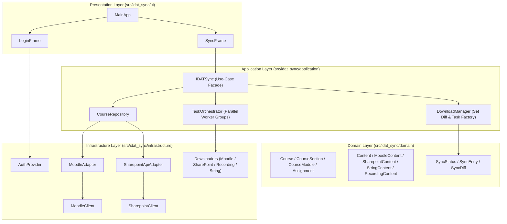

# IDAT Sync — Architecture & Design Decisions

This document captures the architectural design, refactoring decisions, and design patterns established for `idat-sync`.

---

## 1. Problem Context & Goals

1. **Moodle-Driven Folder Hierarchy**:
   - Course structure (`Course` $\rightarrow$ `CourseSection` $\rightarrow$ `CourseModule`) lives in Moodle (`aulavirtual.idat.edu.pe`).
   - Teachers sometimes upload external SharePoint links (`idat628.sharepoint.com`, either single files or `:f:` shared folders) inside Moodle modules.
   - Downloaded files must always preserve the **Moodle** folder hierarchy on disk (`<Course>/<Section>/<Module>/...`), while keeping any subfolders *within* a shared `:f:` link nested under that Moodle module folder.
2. **Individual File Tracking for UI & Syncing**:
   - Instead of downloading files one-by-one while walking the remote API, we build a complete flat list of remote [`Content`](src/idat_sync/domain/content.py) items first.
   - Each individual file has its target `path: Path` and `last_modified: int`, allowing fast local-vs-remote diffing and per-file sync status display in the UI before downloading.

---

## 2. Bottom-Up Path Composition (`Content.in_folder`)

Previously, a `parents: list[str]` was passed down from `CourseRepository` into `MoodleAdapter` and `SharepointApiAdapter`, which caused adapters to know about Moodle paths and accidentally overwrite Moodle module folder names with SharePoint root folder names.

### Solution

- [`Content`](src/idat_sync/domain/content.py) stores `path: Path` and provides an immutable [`in_folder(folder)`](src/idat_sync/domain/content.py) helper:
  ```python
  @dataclass
  class Content(ABC):
      path: Path
      last_modified: int

      @property
      def filename(self) -> str:
          return self.path.name

      def in_folder(self, folder: str | Path) -> Self:
          if not folder:
              return self
          return replace(self, path=Path(folder) / self.path)
  ```
- **Adapters** never receive a `parents` argument—they only return paths relative to the URL they resolve:
  - Single file $\rightarrow$ `Path("notes.pdf")`
  - SharePoint `:f:` folder $\rightarrow$ `Path("guia.pdf")`, `Path("Lab1/demo.py")` (recursively wrapped via `.in_folder(sub_folder_name)` as `fetch_folder_contents` unwinds).
- **[`CourseRepository`](src/idat_sync/application/course_repository.py)** wraps items bottom-up at each level of the Moodle hierarchy:
  - Module level wraps items with `.in_folder(module.name)`
  - Section level wraps items with `.in_folder(section.name)`
  - Course level wraps items with `.in_folder(course_dir)`

---

## 3. Fast Local vs. Remote Diffing via Python Set Algebra

To show individual file sync states in the UI without downloading first, [`DownloadManager.diff_trees`](src/idat_sync/application/download_manager.py) indexes the remote tree (`dict[Path, Content]`) and scans the local directory once (`dict[Path, int]`), then applies set operations on their key views:

- **Missing Locally ($R \setminus L$)**: `missing_paths = remote_keys - local_keys` $\rightarrow$ `SyncStatus.MISSING`
- **Present in Both ($R \cap L$)**: `common_paths = remote_keys & local_keys`
  - `outdated_paths` (where `remote.last_modified > local_mtime`) $\rightarrow$ `SyncStatus.OUTDATED`
  - `synced_paths = common_paths - outdated_paths` $\rightarrow$ `SyncStatus.SYNCED`
- **Local Only ($L \setminus R$)**: `local_only_paths = local_keys - remote_keys` $\rightarrow$ `SyncStatus.LOCAL_ONLY`
- **Pending Downloads**: `to_download_paths = missing_paths | outdated_paths`

---

## 4. Software Architecture & Design Patterns

### Layered / Hexagonal Architecture



### Core Patterns Used

1. **Client $\rightarrow$ Adapter (Anti-Corruption Layer)**:
   - [`MoodleClient`](src/idat_sync/infrastructure/moodle_client.py) and [`SharepointClient`](src/idat_sync/infrastructure/sharepoint_client.py) handle low-level HTTP/SDK calls and rate limiting.
   - [`MoodleAdapter`](src/idat_sync/infrastructure/moodle_adapter.py) and [`SharepointApiAdapter`](src/idat_sync/infrastructure/sharepoint_adapter.py) translate vendor responses into domain models.
2. **Repository Pattern**:
   - [`CourseRepository`](src/idat_sync/application/course_repository.py) provides a read-only domain query interface that combines Moodle courses/sections/modules and SharePoint links/recordings into a unified remote tree (`list[Content]`).
3. **Command + Strategy Pattern (Double Dispatch)**:
   - Each [`Content`](src/idat_sync/domain/content.py) dispatches to the matching [`Downloader`](src/idat_sync/infrastructure/downloaders.py) strategy to create a self-contained [`DownloadTask`](src/idat_sync/infrastructure/downloaders.py) command (`task.download()`).
4. **Parallel Pipeline Orchestration**:
   - [`TaskOrchestrator`](src/idat_sync/application/task_orchestrator.py) executes independent downloader groups (`[MoodleDownloader]`, `[StringDownloader]`, `[SharepointDownloader, RecordingDownloader]`) concurrently while keeping tasks within the same rate-limited backend sequential.

---

## 5. Package Layout

```text
src/idat_sync/
├── domain/                  # Pure dataclasses & enums (no I/O imports)
│   ├── course.py            # Course, CourseSection, CourseModule, Assignment, ModuleContent
│   ├── content.py           # Content, MoodleContent, SharepointContent, StringContent, RecordingContent
│   └── sync.py              # SyncStatus, SyncEntry, SyncDiff
├── infrastructure/          # External APIs, SDKs, and file I/O
│   ├── auth.py              # AuthProvider, Credentials
│   ├── moodle_client.py     # Raw Moodle REST calls
│   ├── moodle_adapter.py    # Maps Moodle JSON -> domain models
│   ├── sharepoint_client.py # Raw Office365 SDK calls
│   ├── sharepoint_adapter.py# Maps SharePoint objects -> SharepointContent
│   └── downloaders.py       # Downloader strategies & DownloadTask commands
├── application/             # Use-cases & orchestration
│   ├── course_repository.py # Builds unified remote tree
│   ├── download_manager.py  # Set-based tree diffing & task creation
│   ├── task_orchestrator.py # Parallel group execution
│   └── sync_service.py      # IDATSync facade
└── ui/                      # Tkinter views
    ├── app.py               # MainApp, AppFrame, ProgressInterceptor
    ├── dialogs.py           # LoadingDialog
    ├── login_frame.py       # LoginFrame
    └── sync_frame.py        # SyncFrame
```
